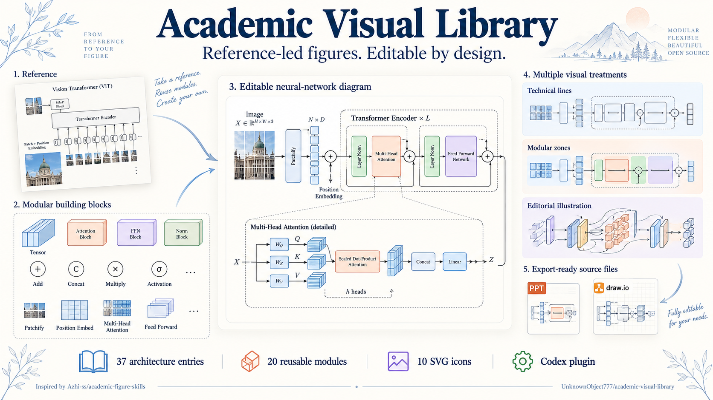
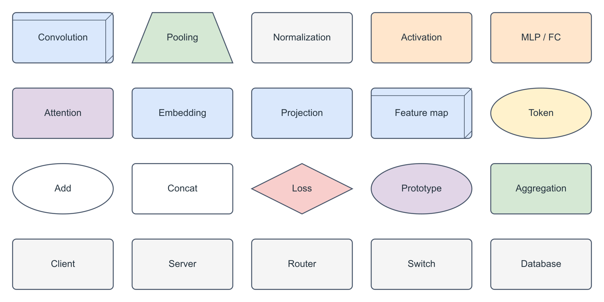

# Academic Visual Library

**Reference-led figures. Editable by design.**



[中文说明](README.zh-CN.md) · [Visual catalogue](skills/academic-visual-assets/references/catalog.md) · [Credits](THIRD_PARTY_NOTICES.md)

A multimodal-first academic figure workflow for Codex: inspect your reference and scientific material, choose reusable visual parts, draw, then inspect and repair the actual result. Open-ended reference styles and editable architecture assets live in the same lightweight plugin.

## What makes it useful

- **Use your reference's actual visual language.** Composition, illustration, surfaces, strokes, typography and semantic colors—not just a preset palette.
- **Reuse real editable material.** 37 architecture entries, 20 module primitives, 10 SVG icons, draw.io libraries and native PowerPoint shapes/text/connectors.
- **Let the model reason directly.** No mandatory FigureSpec, serialized scene graph, prompt hashes or intermediate compiler. Actual editor formats are still used where needed.
- **Keep the science grounded.** Code and papers determine relationships; a style reference never supplies a new algorithm or result.
- **Check the produced figure.** Local edits preserve explicit invariants; the new entire figure is re-inspected rather than inheriting an old pass.

### Three entry points

| Skill | Purpose |
|---|---|
| `academic-figure-workflow` | Draw/edit, prompt construction/diagnosis/revision, inspection and editable delivery |
| `academic-figure-analyzer` | Read the relevant paper, code or reference; return concise grounded findings |
| `academic-visual-assets` | Visually browse templates, reuse native modules and adapt icons/colors |

Use only what the current task needs. The plugin adds resources and procedures to a capable multimodal agent; it does not train a new model or require a separate paid API/MCP service.

## Install in Codex

```bash
codex plugin marketplace add UnknownObject777/academic-visual-library
codex plugin add academic-visual-library@academic-visual-library
```

For a local checkout, replace the first command's repository with its absolute folder path. Reopen the client/session if the new plugin does not appear. Native image generation needs the current session's image tool; editable drawing needs available document/vector tools. Browse/use the bundled files offline without rerunning the asset builder.

Example requests:

> Use academic-figure-workflow to draw our method in this reference image's style. Preserve the training/inference boundary and deliver editable draw.io or PPT source.

> Use academic-visual-assets to find a suitable attention block. Adapt its appearance to this reference; verify pre/post normalization and residual paths against our code.

> Diagnose this figure prompt; do not generate an image or edit files.

## Browse the actual material



- [Network sheet 1](assets/gallery/models-1.png) / [sheet 2](assets/gallery/models-2.png)
- [SVG device icons](assets/gallery/icons.png)
- [Native module PPT](assets/pptx/modules.pptx) / [network PPT](assets/pptx/network-models.pptx)
- [Original model draw.io library](assets/drawio/nn-model-library.xml) / [SVG device draw.io library](assets/drawio/device-icons.xml)

There are 36 named architecture entries and one untitled upstream entry. The libraries are starting points, not certified implementations. Adapt dimensions, connectivity, normalization and masks to the target method.

## Inspired by, then extended

This project is inspired by [Azhi-ss/academic-figure-skills](https://github.com/Azhi-ss/academic-figure-skills), including its recent analyzer/workflow split, reference-aware prompt design and revision discipline. We acknowledge that groundwork and retain the required MIT notices.

Our contribution is a **multimodal-first, editable-asset-centered extension**: simplified three-entry routing, direct reasoning without mandatory IR, visual browsing of reusable network parts, native object-level architecture output, and clear boundaries between editable objects, vector pictures and raster illustration. We also carry forward scientific grounding, explicit edit invariants and re-inspection of each new render.

These are concrete workflow and material improvements for our use case, not a measured claim of universal superiority over the upstream project. See [the upstream integration notes](docs/upstream-integration.md).

## Output boundaries

| Output | What is actually editable |
|---|---|
| Bundled/native draw.io or PPT architecture | Shapes, labels and connectors supported by the selected tools |
| SVG icon inserted into PPT | A scalable picture asset; native path editing requires conversion |
| Generated poster/illustration | A raster image, not a native editable diagram |
| Raster background plus native text | Text boxes are editable; the background remains raster |

`scripts/drawio_assets.py` is a **limited primitive renderer**, not a complete draw.io converter. Browsing previews and PPT derivatives can simplify original styles; original draw.io remains the source of truth for template appearance. Final publication geometry and appearance should be checked in the target editor.

Palette examples are local conventions, **not an IEEE-mandated color standard**. Empirical charts must use real data. Open-ended style support does not guarantee pixel-perfect reproduction.

## Validation and development

```bash
python -m pip install python-pptx
python -m unittest discover -s tests -v
```

Optional preview regeneration requires Node and `sharp`:

```bash
node scripts/render_gallery.cjs .
```

Actual template parsing, PPT native-object round trips, source hashes and link checks are covered. Module PPT was also rendered and visually inspected in PowerPoint locally. Cross-model performance comparisons and arbitrary-style end-to-end benchmarks have not been performed. The Imagegen poster illustrates the workflow; it is not an experimental architecture result.

MIT for local code/instructions; bundled materials retain their separate notices. See [LICENSE](LICENSE), [third-party notices](THIRD_PARTY_NOTICES.md) and [asset provenance](assets/provenance.json).
