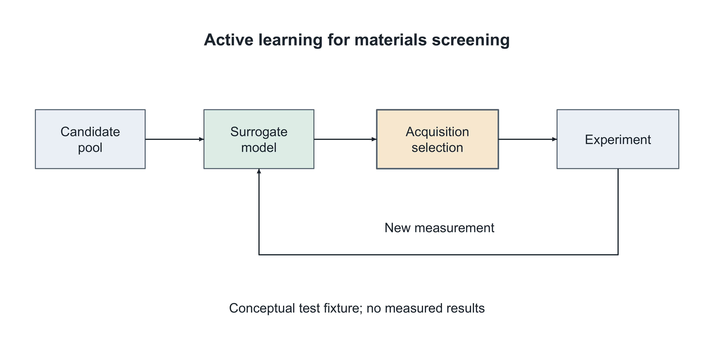

# Text to native editable PowerPoint figures

Plugin v0.3.0 integrates the v5.0.0 figure-skill suite. It retains the analyzer, visual catalogue, editable network assets and illustration workflow while adding a tested native figure/editing branch.

## Use

> Use academic-figure-workflow to turn this paper's method section into a figure. Match the supplied reference's visual language while deriving the scientific relationships from the paper. Deliver native editable PPT and a publication PNG. Check the actual insertion width and inspect the final render before delivery.

> Based on this editable deck, change only the specified mechanism: unify arrow shaft/head geometry and align repeated feature bars relative to their panel frames. Preserve the other regions and synchronize the independent detail canvas.

Read the workflow's [text-to-figure](../skills/academic-figure-workflow/prompts/text-to-editable-figure.md), [reference-transfer](../skills/academic-figure-workflow/prompts/reference-to-editable-figure.md) and [local-revision prompts](../skills/academic-figure-workflow/prompts/revise-figure.md) for adaptable examples. Missing optional style fields do not force a form or approval round.

## What makes the process reusable

Scientific sources determine entities, directed relationships and boundaries. Inspected references determine visual language. Concrete fonts, semantic colors, opacities, stroke/head dimensions and physical geometry stabilize the chosen treatment across panels and revisions. These are authoring decisions, not a compulsory serialized scene schema.

Native mechanism objects and real text remain editable. Source-backed layouts can vary across papers: no universal server, client count, four-panel grid, LOSS symbol or palette is prescribed. Photos, textures, external plots and complex equations have their actual editability boundary disclosed.

## Executable tools

Inside `skills/academic-figure-workflow/scripts/`:

| Tool | Purpose |
|---|---|
| `figure-native.mjs` | Millimeter geometry, point typography, native labels/shapes, one arrow family, relative grids and shared viewports |
| `patch_native_shapes.py` | Scoped standalone-shape replacement with preserved unselected objects and package parts |
| `audit_pptx.py` | Final-size fonts, native objects, frame-relative alignment, arrow geometry and baseline preservation |
| `export_powerpoint.ps1` | Actual PowerPoint PNG export through a unique temporary copy; actual text-bound measurements |
| `png_dpi.py` | Resolution metadata updates without resampling image pixels |

New native authoring uses the current Codex-provided artifact runtime. Discover its Node/package paths rather than installing a substitute or embedding a workstation path. The Python inspection/patching tools use the standard library. Actual Windows rendering requires PowerPoint; use another supported renderer elsewhere and disclose any unavailable visual check.

## Example and tests



[Editable example](../assets/examples/active-learning.pptx) · [synthetic source excerpt](../skills/academic-figure-workflow/examples/active-learning.md) · [authoring example](../skills/academic-figure-workflow/examples/active-learning.mjs)

The example is a synthetic materials-screening loop, not a published method or an empirical result. It contains 12 native visual shapes, 10 text runs and no raster pictures. Its canvas is 182 × 86 mm, essential type is 9.5 pt, and the PNG is 4299 × 2031 at 600 dpi. PowerPoint rendering and actual text-bound inspection found no overflow in this example.

```bash
node skills/academic-figure-workflow/tests/test_native.mjs
python skills/academic-figure-workflow/tests/test_pptx_tools.py assets/examples/active-learning.pptx
python skills/academic-figure-workflow/scripts/audit_pptx.py assets/examples/active-learning.pptx --require-native --min-font-pt 9.5
```

The 11 package/PNG regression tests cover final-size type failure, font mismatch, scoped preservation, unique new IDs, unsupported relationship refusal, intentional deletion, canvas mismatch, relative alignment, arrow weight and PNG pixel preservation. Component tests cover shared geometry and straight/curved arrow construction. Mechanical success does not certify scientific interpretation, reference fidelity or arbitrary-style native conversion; each final figure still needs actual visual review.

## Entry points and versions

The plugin retains `academic-figure-workflow`, `academic-figure-analyzer` and `academic-visual-assets`. The v5 suite also exposes `academic-figure-designer`, `academic-figure-draft-analyzer`, `academic-figure-architecture-extractor` and `academic-repo-analyzer` for focused work. Consult only the analysis needed for the task; no serial five-agent pipeline is required.

For standalone installation, copy all five v5 skill directories together into your Codex skills directory. The separate analyzer/assets plugin entries remain available when the full plugin is installed. Bundled reference assets retain their licenses and notices.
